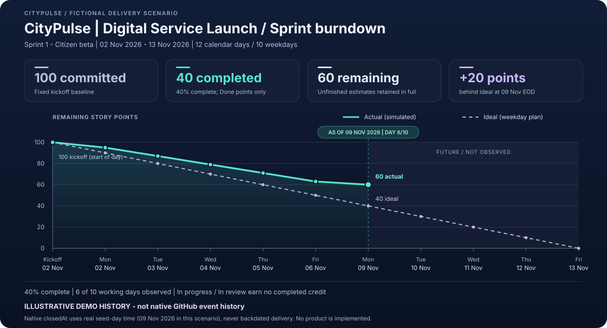

# CityPulse · a complete GitHub Projects demo

**One repository. One linked Project. Fifty real issues. One focused sprint.**

A fictional city is launching a citizen-service portal: residents find a service,
submit a request, track progress, and receive updates; staff triage and resolve the
work. The scenario is familiar enough to explain in a minute and rich enough to
show the complete planning-to-delivery story.

> **Start with the repository's [Projects tab](https://github.com/alvine-aurelio-org/citypulse-projects-demo/projects).**
> Open **CityPulse | Digital Service Launch**, then choose **03 - Sprint 1 board**.
> Everything is pre-populated; presenters do not need to seed data or install tools.

**[OPEN THE SPRINT BOARD](https://github.com/orgs/alvine-aurelio-org/projects/11/views/3)** ·
**[Portfolio](https://github.com/orgs/alvine-aurelio-org/projects/11/views/1)** ·
**[Roadmap](https://github.com/orgs/alvine-aurelio-org/projects/11/views/4)** ·
**[Sprint Insights](https://github.com/orgs/alvine-aurelio-org/projects/11/insights/2)**

**[Sprint report and daily numbers](reports/sprint-1.md)** ·
**[Presentation guide](docs/demo-guide.md)** ·
**[Capabilities and boundaries](docs/capabilities.md)** ·
**[Auditable CSV](reports/sprint-1-burndown.csv)**

### Instructor walkthrough — PDF

**[Open the 24-page instructor PDF](docs/instructor-walkthrough.pdf)**

Use the PDF beside the browser: every stop includes the click path, what to show,
expected figures, a spoken script, an audience question and answer, safety advice,
and an exit check. Choose the 30–40 minute full route, the 15-minute fast track,
or the five-minute executive route. It covers all seven views, all four charts,
native issue hierarchy, dependencies, milestones, risk updates, PRs, Actions,
automation, troubleshooting, and an optional reversible status demonstration.

Live links and PDF bookmarks make it usable while presenting. Visuals are explicitly
labeled instructional schematics, not authenticated GitHub screenshots; the burndown
uses the existing repository chart. The frozen scenario and the intentionally open
review PR remain unchanged. Presenters do not need to install anything.

## The environment at a glance

| Capability | Ready-to-demo content |
| --- | --- |
| Portfolio | 5 real epic issues, each with 9 native sub-issues: **50 issues total** |
| Delivery lifecycle | Backlog **10**, Ready **10**, In progress **10**, In review **5**, Blocked **5**, Done **10** |
| One sprint | **Sprint 1 - Citizen beta**, November 2–13, 2026; 30 delivery issues, **100 points** |
| Progress | **40 completed / 60 remaining**; 5 blocked issues representing 10 points |
| Planning fields | Status, Priority, Estimate, Team, Workstream, Risk, Sprint, Start date, Target date |
| Native issue features | Feature / Task / Bug types, labels, milestones, actual assignees, parent-child progress, dependencies |
| Delivery horizons | Citizen beta → Operations readiness → Public launch |
| Reporting | Four saved native Insights charts, plus the single-sprint burndown shown above |
| Native automation | Seven enabled rules, including close → Done, reopen → Ready, and linked PR → In review |
| Pull requests | A merged demo-assembly example and an open design-review example; neither adds a card to the 50-item Project |
| Presenter experience | A guided 10–15 minute tour, realistic acceptance criteria, risk narrative, and repeatable verification |

**A point is counted once.** Epics have zero estimates; only their delivery children
contribute to effort. The sprint contains 30 of the 45 child issues. The remaining
15 children are deliberately outside the sprint, so backlog is not confused with commitment.

## Seven lenses on the same work

| Saved Project view | What to show |
| --- | --- |
| **[01 - Portfolio backlog](https://github.com/orgs/alvine-aurelio-org/projects/11/views/1)** | All 50 issues grouped by Workstream, native hierarchy, Type and sub-issue progress columns |
| **[02 - Delivery board](https://github.com/orgs/alvine-aurelio-org/projects/11/views/2)** | All 45 delivery children moving through six lifecycle columns with estimate sums |
| **[03 - Sprint 1 board](https://github.com/orgs/alvine-aurelio-org/projects/11/views/3)** | Only the 30 committed sprint issues; effort totals tell the delivery story |
| **[04 - Release roadmap](https://github.com/orgs/alvine-aurelio-org/projects/11/views/4)** | Five epic date bars with Sprint and Milestone markers |
| **[05 - Team workload](https://github.com/orgs/alvine-aurelio-org/projects/11/views/5)** | Open delivery work grouped by fictional delivery team, with count and point sums |
| **[06 - Risks and blockers](https://github.com/orgs/alvine-aurelio-org/projects/11/views/6)** | Five blocked issues arranged by Workstream, each carrying a real unresolved prerequisite |
| **[07 - Bug triage](https://github.com/orgs/alvine-aurelio-org/projects/11/views/7)** | Eight native Bug-type issues grouped by Priority |

The Project is organization-owned, as GitHub Projects are. It is explicitly linked
to this repository and surfaced in its Projects tab; no second repository is required.

## The sprint story

The scenario is frozen at **November 9, 2026, end of day**. Six of ten working days
have elapsed. The ideal line has **40 points remaining**, but the example has **60**:
it is **20 points behind the ideal**. Reviews and in-progress work earn no partial
completion credit. The next stand-up should focus on the five unresolved dependencies
and finishing review work, not starting more backlog.

### Important reporting distinction

This is **seeded, fictional delivery data**, not a claim that the CityPulse product
has been built, tested, approved, or deployed. GitHub issues and Project items are
real; their native creation/closure events occur when the environment is provisioned.

The burndown's earlier daily completions are **explicit illustrative history** derived
from the issue catalogue. They are **not backdated GitHub events**. Future actuals are
blank, never invented. GitHub's native historical Insights chart is a **burn-up**;
the ready-made burndown here supplies the conventional remaining-versus-ideal view.
See [reporting provenance](docs/capabilities.md#reporting-provenance).

### Native Insights, ready to open

- **[Delivery status](https://github.com/orgs/alvine-aurelio-org/projects/11/insights/1)** — all 50 issues, Count by Status.
- **[Sprint 1 - Effort by status](https://github.com/orgs/alvine-aurelio-org/projects/11/insights/2)** — the 100-point sprint, Sum of Estimate by Status.
- **[Team workload](https://github.com/orgs/alvine-aurelio-org/projects/11/insights/3)** — 140 open delivery points by Team, excluding epics.
- **[Sprint 1 - Native burn up](https://github.com/orgs/alvine-aurelio-org/projects/11/insights/4)** — native events, November 2–9; real seeded totals appear on November 9.

## Code and review, without changing the 50-issue scope

The repository includes an actual merged assembly pull request and an intentionally
open design-review pull request for **#8**. Open the **[Pull requests tab](https://github.com/alvine-aurelio-org/citypulse-projects-demo/pulls)**
to show a real diff and hosted CI. The open design proposal is not an approval and
must not be merged merely to make the demo look complete. Both PRs stay outside
the Project's 50 issue cards. See [verified environment details](docs/verification.md).

## Five workstreams

1. **Citizen onboarding** — minimum-data profiles, consent, preferences, accessible setup.
2. **Service catalogue** — discoverable services, accessible filters, governed publishing.
3. **Request tracking** — request references, understandable statuses, notification journeys.
4. **Staff operations** — queue ownership, safe triage, escalation, support handoffs.
5. **Release and reliability** — service objectives, incident communication, launch decisions.

Only the verified real GitHub operator is assigned to sample issues. **Team** and
the roles in issue descriptions are fictional demo groupings, not fabricated users
or grants of organization access. Some Ready and Backlog issues remain unassigned
to make the ownership discussion useful.

## Maintenance, not presenter setup

Node.js 24 and the standard GitHub CLI are used by maintainers. There are **no npm
runtime dependencies**, no PATs or cloud resources, and no credentials in this repository.
Maintainers run `npm ci --ignore-scripts` to install the pinned development-only
PDF authoring/validation tools; this is not a presenter setup step.

- `npm test` checks the catalogue, reporting calculations, provisioning safety, and content.
- `npm run verify` validates reports, documentation, source hygiene, and the actual PDF without GitHub access.
- `npm run walkthrough:build` regenerates the source-bound PDF using a local Edge/Chromium browser.
- `npm run walkthrough:verify` checks all 24 pages, full text, bookmarks, tags, safe links, and source hashes.
- `npm run walkthrough:render` additionally rasterizes every PDF page and creates ignored inspection contact sheets.
- `npm run verify:live` performs a read-only reconciliation against this exact demo repository and Project.
- The two `seed:*` scripts require normal GitHub authentication and reconcile existing demo markers;
  they do not create a second repository, delete existing work, or silently duplicate issues.

The credential-free validation workflow runs on pushes and pull requests. Native
Project automation remains in GitHub; its settings are documented in the guide.

## Keeping the demo credible

- All 50 native issues count toward the total, including the five epics.
- No extra draft items or pull requests are added to the 50-item Project.
- Dates and scenario progress are explicitly fictional; native state is independently verifiable.
- The burndown is checked against the exact sprint issue estimates and completion declarations.
- Changes made during a live presentation intentionally change the environment; the frozen
  report stays a clearly dated baseline until a maintainer deliberately updates the catalogue.
- Session publication and checks are recorded on the **dev** branch in the
  [daily work report](https://github.com/alvine-aurelio-org/citypulse-projects-demo/blob/dev/docs/daily%20work%20report/2026-11-09.md).
