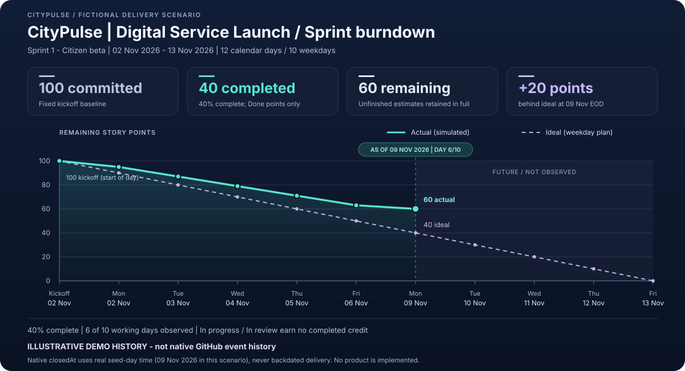

# CityPulse \| Digital Service Launch - Sprint 1 delivery report

> **ILLUSTRATIVE DEMO HISTORY - not native GitHub event history**
> This repository is a fictional delivery/demo state, not an implemented product. Done does not prove that functionality was built, tested, approved, or deployed.

## Sprint snapshot

- **Sprint:** Sprint 1 - Citizen beta; **2026-11-02 to 2026-11-13**, inclusive.
- **Calendar:** 12 calendar days / 10 weekday working days; weekends are omitted from daily rows.
- **As of:** 2026-11-09, end of day UTC; working day **6 of 10**.

| Metric | Declared scenario value |
| --- | --- |
| Committed scope | 30 issues / 100 story points |
| Completed | 10 Done issues / 40 story points |
| Remaining | 60 story points |
| Completion | 40% of committed points |
| Blocked (part of remaining scope) | 5 issues / 10 story points |
| Ideal remaining at the as-of EOD | 40 story points |
| Difference from ideal | +20 points (behind ideal) |

The **30 committed issues** total **100 points**: **40 completed** and **60 remaining** (40% complete). At 2026-11-09 EOD, ideal remaining is **40** versus actual **60**, so the scenario is **20 points behind ideal**. The **5 blocked issues / 10 points** are included in, not added to, remaining work.

Scope excludes **5 zero-point epics** and **15 non-sprint children**. Epics are always excluded, even if marked sprint=true, to prevent double counting. The kickoff baseline stays fixed at 100 points.

## Daily remaining points

Kickoff is the start of the first calendar day, before any completion credit. Each later row is weekday end of day. Ideal work burns evenly over weekdays. Only full estimates of Done issues with a declared simulated doneDate at or before both the row date and the as-of cutoff earn completion credit. In progress and In review earn **no partial completed credit**.

| Date (UTC) | Phase | Ideal remaining | Actual remaining | Scope points |
| --- | --- | ---: | ---: | ---: |
| 2026-11-02 | Kickoff - start of day | 100 | 100 | 100 |
| 2026-11-02 | Weekday end of day | 90 | 95 | 100 |
| 2026-11-03 | Weekday end of day | 80 | 87 | 100 |
| 2026-11-04 | Weekday end of day | 70 | 79 | 100 |
| 2026-11-05 | Weekday end of day | 60 | 71 | 100 |
| 2026-11-06 | Weekday end of day | 50 | 63 | 100 |
| 2026-11-09 | Weekday end of day | 40 | 60 | 100 |
| 2026-11-10 | Weekday end of day | 30 | not observed | 100 |
| 2026-11-11 | Weekday end of day | 20 | not observed | 100 |
| 2026-11-12 | Weekday end of day | 10 | not observed | 100 |
| 2026-11-13 | Weekday end of day | 0 | not observed | 100 |

**not observed** means a future actual is null/empty, not zero. The actual line stops at the as-of marker; it contains no projection. [Download the auditable CSV](sprint-1-burndown.csv), including a provenance column on every data row.

## Declared completed issues - simulated dates, not native timestamps

These 10 numbered links identify declared demo Done issues only, not delivered functionality. The dates are **simulated completion dates**, not native GitHub closedAt timestamps.

1. [#6 - Define the minimum-data citizen profile](https://github.com/alvine-aurelio-org/citypulse-projects-demo/issues/6) - **5 points**; simulated completion: **2026-11-02**.
2. [#7 - Specify consent and profile retention choices](https://github.com/alvine-aurelio-org/citypulse-projects-demo/issues/7) - **3 points**; simulated completion: **2026-11-03**.
3. [#15 - Define searchable service cards](https://github.com/alvine-aurelio-org/citypulse-projects-demo/issues/15) - **5 points**; simulated completion: **2026-11-03**.
4. [#16 - Correct accent handling in catalogue query examples](https://github.com/alvine-aurelio-org/citypulse-projects-demo/issues/16) - **3 points**; simulated completion: **2026-11-04**.
5. [#24 - Define non-identifying public request references](https://github.com/alvine-aurelio-org/citypulse-projects-demo/issues/24) - **5 points**; simulated completion: **2026-11-04**.
6. [#25 - Map citizen-visible request states](https://github.com/alvine-aurelio-org/citypulse-projects-demo/issues/25) - **3 points**; simulated completion: **2026-11-05**.
7. [#33 - Define the staff triage queue contract](https://github.com/alvine-aurelio-org/citypulse-projects-demo/issues/33) - **5 points**; simulated completion: **2026-11-05**.
8. [#34 - Prepare escalation and ownership handover rules](https://github.com/alvine-aurelio-org/citypulse-projects-demo/issues/34) - **3 points**; simulated completion: **2026-11-06**.
9. [#42 - Define beta SLO and error-budget policy](https://github.com/alvine-aurelio-org/citypulse-projects-demo/issues/42) - **5 points**; simulated completion: **2026-11-06**.
10. [#43 - Prepare release threat-model boundaries](https://github.com/alvine-aurelio-org/citypulse-projects-demo/issues/43) - **3 points**; simulated completion: **2026-11-09**.

## Provenance and GitHub native charts

The historical daily series is an explicitly illustrative scenario calculated locally from declared dates. Native closures in the planned **2026-11-09 seed run** retain their real seed-day timestamps; earlier scenario dates do not describe those native events. This report neither reads nor backdates GitHub event history, and it makes no application implementation, deployment, or live health claim.

- GitHub's official [About insights for Projects](https://docs.github.com/en/issues/planning-and-tracking-with-projects/viewing-insights-about-your-project/about-insights-for-projects) explains native project charts, including historical **burn-up** charts. Burn-up shows completed work increasing over time; this local burndown shows remaining points decreasing.
- The official [Creating charts](https://docs.github.com/en/issues/planning-and-tracking-with-projects/viewing-insights-about-your-project/creating-charts) guide describes native chart configuration. These local reports do **not** seed native chart history or assert that a chart API supports historical event seeding.
